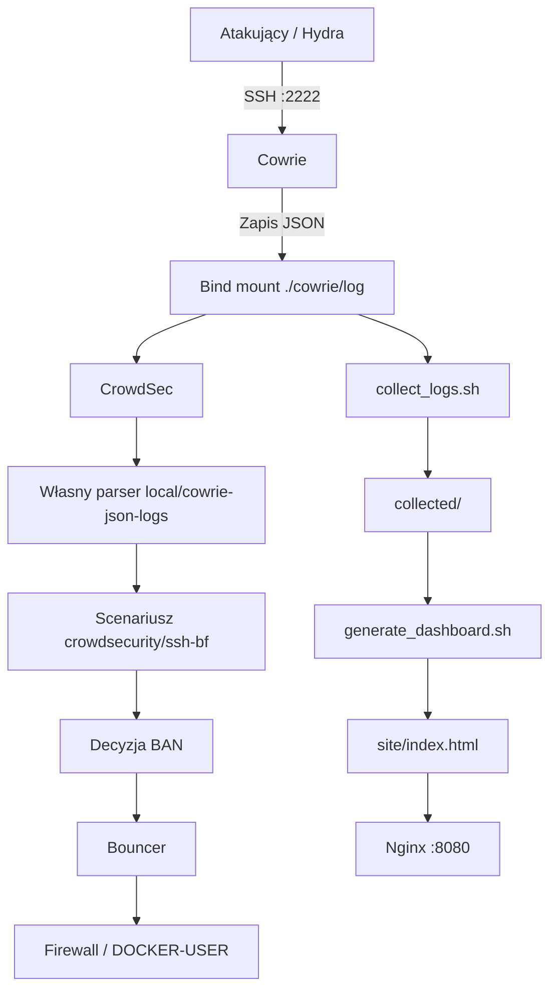

# Architektura projektu

## 1. Cel architektury

Projekt realizuje zamkniętą pętlę bezpieczeństwa:

**atak → detekcja → decyzja → blokada**

Atakujący wykonuje kontrolowane próby połączenia z honeypotem SSH Cowrie. Cowrie rejestruje zdarzenia w logach JSON. CrowdSec odczytuje logi, interpretuje je za pomocą własnego parsera i wykrywa podejrzane zachowania. Po spełnieniu warunków scenariusza CrowdSec podejmuje decyzję o zablokowaniu adresu IP. Bouncer wykonuje tę decyzję na poziomie firewalla.

Dodatkowo skrypty Bash + `jq` analizują logi Cowrie i generują dane wykorzystywane przez statyczny dashboard HTML. Dashboard jest udostępniany przez Nginx.

Główne elementy systemu:

- **Cowrie** – honeypot SSH i źródło logów.
- **CrowdSec** – analiza zdarzeń i wykrywanie ataków.
- **Własny parser CrowdSec** – interpretacja logów JSON Cowrie.
- **Bouncer** – egzekwowanie decyzji przez firewall.
- **Bash + jq** – dodatkowa analiza logów.
- **Dashboard + Nginx** – prezentacja wyników.

---

## 2. Architektura systemu

```text
┌──────────────────────────┐
│        ATAKUJĄCY         │
│                          │
│  attacker/               │
│  Hydra / test client     │
└────────────┬─────────────┘
             │
             │ SSH :2222
             ▼
┌──────────────────────────┐
│          COWRIE          │
│                          │
│   Honeypot SSH           │
│   średniej interakcji    │
└────────────┬─────────────┘
             │
             │ zapis zdarzeń JSON
             ▼
┌──────────────────────────┐
│       ./cowrie/log       │
│                          │
│   cowrie.json            │
│                          │
│   Bind mount             │
└────────────┬─────────────┘
             │
       ┌─────┴──────────────────────┐
       │                            │
       ▼                            ▼
┌───────────────────┐     ┌──────────────────────┐
│     CrowdSec      │     │   collect_logs.sh    │
│                   │     │                      │
│ własny parser     │     │ Bash + jq            │
│ scenariusz SSH    │     │ analiza logów        │
│ detekcja          │     └──────────┬───────────┘
│ decyzje           │                │
└────────┬──────────┘                ▼
         │                  ┌──────────────────────┐
         │                  │     collected/       │
         │                  │                      │
         │                  │ top_ips.json         │
         │                  │ commands.jsonl       │
         │                  │ downloads.jsonl      │
         │                  └──────────┬───────────┘
         │                             │
         │ decyzja: BAN                ▼
         ▼                  ┌──────────────────────┐
┌───────────────────┐       │ generate_dashboard.sh│
│      Bouncer      │       │                      │
│                   │       │ Bash + jq + HTML     │
│ firewall          │       └──────────┬───────────┘
│ DOCKER-USER       │                  │
└───────────────────┘                  ▼
                             ┌──────────────────────┐
                             │    site/index.html   │
                             └──────────┬───────────┘
                                        │
                                        ▼
                             ┌──────────────────────┐
                             │        Nginx         │
                             │      HTTP :8080      │
                             └──────────────────────┘
```

### Diagram Mermaid

Poniższy diagram przedstawia główny przepływ danych i decyzji w systemie:



---

## 3. Komponenty systemu

| Komponent | Rola | Odpowiedzialność |
|---|---|---|
| **Cowrie** | Czujnik | Przyjmuje połączenia SSH i rejestruje działania atakującego |
| **CrowdSec** | Mózg | Analizuje logi, wykrywa wzorce i podejmuje decyzje |
| **Parser `local/cowrie-json-logs`** | Interpreter | Przekształca zdarzenia JSON Cowrie do formatu rozumianego przez CrowdSec |
| **Bouncer** | Egzekutor | Wykonuje decyzje CrowdSec i blokuje adresy IP |
| **collect_logs.sh** | Analiza | Parsuje logi JSON za pomocą `jq` |
| **generate_dashboard.sh** | Wizualizacja | Generuje statyczny dashboard HTML |
| **deploy.sh** | Wdrożenie | Automatyzuje przygotowanie i uruchomienie środowiska |
| **verify_ban.sh** | Weryfikacja | Sprawdza, czy blokada adresu IP rzeczywiście działa |
| **enrich_ip.sh** | Wzbogacanie danych | Opcjonalnie uzupełnia informacje o adresach IP |
| **Nginx** | Publikacja | Udostępnia dashboard przez HTTP |
| **attacker** | Generator testów | Wykonuje kontrolowane próby logowania |

---

## 4. Przepływ danych

### 4.1. Atakujący

Kontener `attacker` reprezentuje kontrolowane środowisko atakującego.

Do generowania prób logowania wykorzystywane jest narzędzie Hydra.

Ruch jest kierowany do Cowrie na porcie:

```text
2222
```

Port `22` hosta nie jest wykorzystywany przez honeypot. Dzięki temu prawdziwa usługa SSH systemu hosta pozostaje niezależna od środowiska testowego.

Przykładowy przepływ:

```text
attacker
   │
   │ SSH :2222
   ▼
Cowrie
```

### 4.2. Cowrie

Cowrie działa jako honeypot SSH średniej interakcji.

Jego zadaniem jest udawanie prawdziwego serwera SSH i rejestrowanie działań wykonywanych przez użytkownika.

Cowrie może rejestrować między innymi:

- adres IP klienta,
- nazwę użytkownika,
- próby logowania,
- poprawne i niepoprawne logowania,
- wykonywane komendy,
- próby pobrania plików,
- informacje o sesji,
- znaczniki czasu.

Zdarzenia są zapisywane w formacie JSON. Głównym plikiem wykorzystywanym przez projekt jest:

```text
cowrie.json
```

Każda linia reprezentuje pojedyncze zdarzenie.

**Istotna konfiguracja `userdb.txt`:**

W projekcie wykorzystano wpis:

```text
root:x:!*
```

Wpis ten blokuje możliwość poprawnego zalogowania się jako `root`. Dzięki temu próby logowania kończą się zdarzeniem `login.failed`, które może zostać wykorzystane przez parser i scenariusz CrowdSec do wykrywania brute-force.

Bez odpowiedniej konfiguracji bazy użytkowników Cowrie może zaakceptować logowanie, przez co oczekiwane zdarzenia nieudanych prób logowania nie będą generowane w taki sposób, jak wymaga tego scenariusz.

### 4.3. Współdzielenie logów – bind mount

Logi Cowrie są współdzielone pomiędzy kontenerami za pomocą **bind mount**, a nie Docker named volume.

Katalog na hoście:

```text
./cowrie/log
```

jest wykorzystywany przez trzy elementy:

- Cowrie zapisuje w nim logi.
- CrowdSec odczytuje te same logi w trybie tylko do odczytu.
- Skrypty Bash + `jq` analizują pliki bezpośrednio z hosta.

Przykładowa konfiguracja montowania:

```yaml
volumes:
  - ./cowrie/log:/var/log/cowrie:ro
  - ./cowrie/log:/cowrie/cowrie-git/var/log/cowrie
```

Pierwsze montowanie udostępnia logi kontenerowi CrowdSec w trybie tylko do odczytu. Drugie wskazuje katalog, w którym Cowrie zapisuje logi.

Schemat:

```text
                 COWRIE
                    │
                    │ zapis
                    ▼
          ┌───────────────────┐
          │   ./cowrie/log    │
          │   HOST            │
          └─────────┬─────────┘
                    │
          ┌─────────┴─────────────┐
          │                       │
          ▼                       ▼
   ┌─────────────┐        ┌─────────────────┐
   │  CrowdSec   │        │ collect_logs.sh │
   │  odczyt RO  │        │ Bash + jq       │
   └─────────────┘        └─────────────────┘
```

Takie rozwiązanie pozwala:

- odczytywać logi bezpośrednio z hosta,
- analizować je za pomocą `jq`,
- udostępniać te same dane CrowdSec,
- uniknąć kopiowania plików pomiędzy kontenerami.

Named volume był pierwszą próbą przechowywania logów, ale został zastąpiony bind mountem. Zmiana wynikała z potrzeby łatwego dostępu do plików na hoście oraz współdzielenia jednego katalogu przez Cowrie, CrowdSec i skrypty analityczne.

---

## 5. CrowdSec i własny parser

CrowdSec odpowiada za analizę logów i wykrywanie podejrzanych zachowań.

W projekcie nie wystarcza standardowa kolekcja `crowdsecurity/sshd`, ponieważ jest przeznaczona do logów SSH w formacie syslog, a Cowrie zapisuje zdarzenia w formacie JSON.

Dlatego przygotowano własny parser:

```text
local/cowrie-json-logs
```

### 5.1. Źródło logów

CrowdSec odczytuje logi Cowrie z katalogu udostępnionego przez bind mount.

Konfiguracja `acquis.yaml` wykorzystuje filtr:

```yaml
filter: "evt.Line.Labels.type == 'cowrie'"
```

Dzięki temu CrowdSec przetwarza zdarzenia oznaczone jako pochodzące z Cowrie.

### 5.2. Parsowanie JSON

Własny parser interpretuje surową linię logu JSON.

Wykorzystywane jest między innymi:

```text
UnmarshalJSON(evt.Line.Raw, ...)
```

Pozwala to przekształcić surowe dane Cowrie do struktury zdarzenia rozumianej przez CrowdSec.

### 5.3. Mapowanie pól

Parser dostosowuje nazewnictwo pól Cowrie do formatu oczekiwanego przez CrowdSec.

Najważniejsze mapowanie:

| Pole Cowrie | Pole CrowdSec |
|---|---|
| `src_ip` | `source_ip` |

Dla nieudanych prób logowania wykorzystywany jest typ zdarzenia:

```text
log_type: ssh_failed-auth
```

Dzięki temu scenariusze CrowdSec mogą poprawnie identyfikować źródło prób logowania i grupować zdarzenia według adresu IP.

### 5.4. Scenariusz brute-force

Do wykrywania wielokrotnych nieudanych prób logowania wykorzystywany jest scenariusz:

```text
crowdsecurity/ssh-bf
```

Zdarzenia są grupowane według:

```text
source_ip
```

Schemat działania:

```text
cowrie.json
     │
     ▼
acquis.yaml
     │
     ▼
local/cowrie-json-logs
     │
     ▼
mapowanie pól JSON
     │
     ▼
log_type: ssh_failed-auth
     │
     ▼
crowdsecurity/ssh-bf
     │
     ▼
decyzja BAN
```

---

## 6. Bouncer i blokowanie ruchu Docker

Bouncer odpowiada za wykonanie decyzji podjętej przez CrowdSec.

Rozdzielenie tych dwóch funkcji jest celowe:

```text
CrowdSec
   │
   │ decyzja: zablokuj IP
   ▼
Bouncer
   │
   │ reguła firewalla
   ▼
ruch z danego IP zostaje zablokowany
```

W projekcie wykorzystano bouncer typu firewall, oparty na `iptables`/`nftables`, z uwzględnieniem łańcucha:

```text
DOCKER-USER
```

### 6.1. Dlaczego DOCKER-USER?

Docker zarządza własnymi regułami `iptables` i ruchem pomiędzy kontenerami.

W przypadku sieci Docker typu bridge ruch kontener → kontener może omijać standardowy łańcuch `INPUT`. Dlatego samo dodanie reguły blokującej do `INPUT` nie zapewnia skutecznego blokowania ruchu przekazywanego przez Docker.

Do egzekwowania blokad wykorzystano łańcuch:

```text
DOCKER-USER
```

Jest on przeznaczony do umieszczania własnych reguł filtrowania ruchu przekazywanego przez Docker.

### 6.2. Problem br_netfilter

Podczas testów zidentyfikowano istotny problem związany z filtrowaniem ruchu w sieci bridge.

Ruch kontener → kontener może omijać reguły `iptables`, jeśli nie jest aktywne odpowiednie przetwarzanie pakietów bridge przez netfilter.

Wymagane jest włączenie modułu:

```text
br_netfilter
```

oraz ustawienie parametru:

```text
net.bridge.bridge-nf-call-iptables=1
```

Dzięki temu ruch przechodzący przez most sieciowy Docker może być obsługiwany przez reguły `iptables`.

### 6.3. Wymagania dotyczące działania bouncera

Poprawne blokowanie wymaga więc:

1. aktywnego `br_netfilter`,
2. ustawienia `net.bridge.bridge-nf-call-iptables=1`,
3. wykorzystania łańcucha `DOCKER-USER`,
4. poprawnej integracji bouncera z API CrowdSec,
5. weryfikacji blokady z kontenera testowego.

Istotne jest również utrwalenie konfiguracji `br_netfilter` i parametru sysctl, aby ustawienia pozostawały aktywne po restarcie systemu lub kontenerów.

To jeden z najważniejszych problemów technicznych rozwiązanych podczas projektu. Pokazuje, że samo wykrycie ataku i utworzenie decyzji CrowdSec nie wystarcza — reguła musi jeszcze skutecznie obejmować rzeczywisty przepływ ruchu w środowisku Docker.

---

## 7. Analiza logów przez Bash + jq

Niezależnie od CrowdSec logi są analizowane przez skrypt:

```text
scripts/collect_logs.sh
```

Skrypt wykorzystuje:

```text
Bash + jq
```

Jego zadaniem jest wyciągnięcie najważniejszych informacji z logów Cowrie.

Przykładowe analizowane dane:

- adresy IP atakujących,
- liczba prób logowania,
- używane nazwy użytkowników,
- wykonywane komendy,
- pobierane pliki,
- czas wystąpienia zdarzenia.

Dane wynikowe są zapisywane w katalogu:

```text
collected/
```

Przykładowe pliki:

```text
collected/
├── top_ips.json
├── commands.jsonl
└── downloads.jsonl
```

Katalog `collected/` jest ignorowany przez Git, ponieważ zawiera dane generowane podczas działania systemu.

Analiza Bash + `jq` jest niezależna od mechanizmu detekcji CrowdSec. CrowdSec odpowiada za wykrywanie i decyzje bezpieczeństwa, natomiast skrypty odpowiadają za dodatkowe zestawienia i prezentację danych.

---

## 8. Dashboard

Na podstawie danych wygenerowanych przez `collect_logs.sh` tworzony jest dashboard.

Odpowiada za to:

```text
scripts/generate_dashboard.sh
```

Wynikowy plik znajduje się w:

```text
site/index.html
```

Schemat:

```text
cowrie.json
     │
     ▼
collect_logs.sh
     │
     │ Bash + jq
     ▼
collected/*.json
     │
     ▼
generate_dashboard.sh
     │
     ▼
site/index.html
```

Dashboard jest statycznym plikiem HTML. Projekt nie wykorzystuje osobnego backendu ani frameworka webowego.

Do prezentacji danych wykorzystywane są między innymi:

- HTML,
- CSS,
- JavaScript,
- SVG umieszczone bezpośrednio w HTML (inline SVG).

### Bezpieczeństwo dashboardu

Podczas generowania HTML należy zwracać uwagę na sposób wstawiania danych pochodzących z logów.

Wykorzystanie `@html` pozwala umieszczać zawartość jako HTML, ale jednocześnie może prowadzić do podatności XSS, jeżeli wstawiane dane nie są odpowiednio oczyszczone.

Dane pochodzące od atakującego, takie jak nazwy użytkowników, komendy czy inne wartości zapisane w logach, należy traktować jako niezaufane.

Nie powinny być bezpośrednio wstawiane do HTML bez odpowiedniego zabezpieczenia i escapowania.

---

## 9. Nginx

Nginx odpowiada za udostępnienie wygenerowanego dashboardu.

Plik:

```text
site/index.html
```

jest publikowany przez serwer Nginx.

Schemat:

```text
site/index.html
      │
      ▼
    Nginx
      │
      │ HTTP :8080
      ▼
  przeglądarka
```

Dashboard jest dostępny lokalnie pod adresem:

```text
http://localhost:8080
```

W projekcie należy rozróżnić dwa porty:

| Usługa | Port | Przeznaczenie |
|---|---:|---|
| Nginx | `8080` | Udostępnianie dashboardu |
| CrowdSec LAPI | `8081` | API CrowdSec wykorzystywane przez integrację i bouncera |

Port `8081` został wykorzystany dla LAPI CrowdSec po wystąpieniu kolizji portów. Nginx pozostaje dostępny na porcie `8080`.

Nginx nie odpowiada za analizę logów ani detekcję ataków. Jego zadaniem jest wyłącznie publikacja gotowego pliku HTML.

---

## 10. Zamknięta pętla bezpieczeństwa

Cały projekt można przedstawić w czterech głównych etapach:

```text
┌───────────┐
│   ATAK    │
└─────┬─────┘
      │
      ▼
┌───────────┐
│ DETEKCJA  │
└─────┬─────┘
      │
      ▼
┌───────────┐
│  DECYZJA  │
└─────┬─────┘
      │
      ▼
┌───────────┐
│  BLOKADA  │
└─────┬─────┘
      │
      └───────────────┐
                      │
                      ▼
                  nowe dane
                      │
                      ▼
                    analiza
```

W praktyce proces składa się z dziewięciu kroków:

1. Atakujący wykonuje próbę połączenia SSH.
2. Cowrie przyjmuje połączenie na porcie `2222`.
3. Cowrie zapisuje zdarzenie w pliku `cowrie.json`.
4. CrowdSec odczytuje logi przez bind mount.
5. Własny parser `local/cowrie-json-logs` interpretuje zdarzenia JSON.
6. Scenariusz `crowdsecurity/ssh-bf` wykrywa podejrzany wzorzec i CrowdSec tworzy decyzję o banie.
7. Bouncer wykonuje blokadę przez firewall z wykorzystaniem `DOCKER-USER`.
8. Skrypty Bash + `jq` analizują logi i przygotowują dane.
9. Dashboard prezentuje wyniki w przeglądarce przez Nginx.

W ten sposób projekt realizuje pełny cykl: od rejestracji ataku, przez jego wykrycie, aż po rzeczywistą blokadę źródłowego adresu IP.

---

## 11. Kluczowe decyzje projektowe

### 11.1. Rozdzielenie detekcji od egzekucji

CrowdSec nie musi bezpośrednio wykonywać blokady.

Jego zadaniem jest:

```text
logi → analiza → decyzja
```

Bouncer odpowiada za:

```text
decyzja → blokada
```

Pozwala to na niezależną zmianę mechanizmu egzekucji bez modyfikowania logiki wykrywania ataków.

### 11.2. Bind mount zamiast Docker named volume

Logi są przechowywane na hoście w katalogu:

```text
./cowrie/log
```

Jest to bind mount współdzielony przez Cowrie, CrowdSec i skrypty analityczne.

Zastosowanie bind mounta umożliwia bezpośredni dostęp do logów z poziomu hosta, co ułatwia ich analizę za pomocą `jq` i pozwala udostępnić te same pliki CrowdSec.

Pierwszą próbą był Docker named volume, jednak rozwiązanie zostało zastąpione bind mountem ze względu na wymagany dostęp do logów na hoście i współdzielenie katalogu pomiędzy usługami.

### 11.3. Port 2222 zamiast 22

Cowrie działa na porcie:

```text
2222
```

Zamiast:

```text
22
```

Dzięki temu prawdziwa usługa SSH hosta nie jest zastępowana przez honeypot. Środowisko testowe pozostaje oddzielone od standardowego dostępu administracyjnego do systemu.

### 11.4. Brak własnej bazy danych

Projekt nie dodaje własnej, osobnej bazy danych do przechowywania wyników analizy.

Dane analityczne są zapisywane w plikach JSON i JSONL.

Należy jednak zaznaczyć, że **CrowdSec korzysta z własnej, wbudowanej bazy danych**, przechowywanej w wolumenie:

```text
crowdsec-db
```

Nie oznacza to więc całkowitego braku bazy danych w systemie. Projekt po prostu nie dodaje kolejnej bazy na potrzeby własnego dashboardu i analizy logów.

### 11.5. Statyczny dashboard

Dashboard jest generowany jako statyczny plik HTML:

```text
site/index.html
```

Nie jest potrzebny osobny:

- backend,
- framework JavaScript,
- framework Python,
- serwer aplikacyjny.

Za generowanie odpowiada:

```text
Bash + jq
```

Za publikację:

```text
Nginx
```

Rozwiązanie ogranicza liczbę komponentów i upraszcza uruchamianie projektu.

---

## 12. Bezpieczeństwo i izolacja

Projekt jest przeznaczony do kontrolowanego środowiska laboratoryjnego.

Honeypot powinien działać w odpowiednio odizolowanej sieci Docker. Nie należy wystawiać go bezpośrednio do Internetu bez właściwej konfiguracji zabezpieczeń.

Szczególnie ważne jest rozdzielenie:

```text
HOST
 │
 ├── prawdziwy SSH :22
 │
 └── Docker
      │
      └── Cowrie :2222
```

Dodatkowe elementy bezpieczeństwa:

- ograniczenie dostępu do usług administracyjnych,
- kontrolowanie portów udostępnianych przez Docker,
- prawidłowa konfiguracja reguł firewalla,
- wykorzystanie `DOCKER-USER` do filtrowania ruchu przekazywanego przez Docker,
- utrwalenie ustawień `br_netfilter`,
- nieudostępnianie kluczy API i haseł w repozytorium,
- traktowanie danych z logów jako niezaufanych podczas generowania HTML.

Uprawnienia do współdzielonych logów muszą pozwalać Cowrie na zapis, a CrowdSec i skryptom analitycznym na odczyt.

W projekcie zastosowano między innymi rozwiązanie:

```bash
chown -R 999:999 cowrie/log
```

Alternatywnie można odpowiednio ustawić właściciela katalogu na hoście, zgodnie z użytkownikiem wykorzystywanym przez kontener Cowrie.

---

## 13. Dane w repozytorium

Do repozytorium trafiają:

```text
kod
konfiguracja
skrypty
dokumentacja
Docker Compose
```

Nie powinny trafiać:

```text
logi
dane runtime
hasła
tokeny
klucze API
prywatne klucze
pliki .env
```

Dane runtime są przechowywane poza kontrolą wersji, między innymi w:

```text
cowrie/log/
collected/
```

Katalogi i pliki generowane podczas działania systemu powinny być odpowiednio uwzględnione w `.gitignore`.

Dzięki temu repozytorium zawiera kod i konfigurację potrzebne do odtworzenia projektu, a nie przypadkowe dane z przeprowadzonych testów.

---

## 14. Rozwiązane kwestie techniczne

Podczas realizacji projektu pojawiło się kilka problemów wymagających dodatkowej konfiguracji i testów. Zostały one rozwiązane w kolejnych etapach prac.

| Problem / pytanie | Rozwiązanie zastosowane w projekcie |
|---|---|
| Czy standardowy parser CrowdSec interpretuje logi Cowrie? | Nie. Kolekcja `crowdsecurity/sshd` jest przeznaczona do logów SSH w formacie syslog, a Cowrie zapisuje JSON. |
| Czy potrzebny jest własny parser? | Tak. Przygotowano parser `local/cowrie-json-logs`. |
| Jakie zdarzenia odczytuje CrowdSec? | Konfiguracja `acquis.yaml` wykorzystuje filtr `type == 'cowrie'`. |
| Jak parser przetwarza logi? | Wykorzystuje `UnmarshalJSON(evt.Line.Raw, ...)` do interpretacji surowych zdarzeń JSON. |
| Jak mapowane jest źródłowe IP? | Pole `src_ip` jest mapowane na `source_ip`. |
| Jaki typ zdarzenia wykorzystywany jest przy nieudanym logowaniu? | `log_type: ssh_failed-auth`. |
| Jaki scenariusz wykrywa brute-force SSH? | `crowdsecurity/ssh-bf`, z grupowaniem zdarzeń po `source_ip`. |
| Jaki jest próg prób logowania? | Parametry `capacity` i `leakspeed` są określone w konfiguracji scenariusza. Ich wartości należy odczytywać bezpośrednio z pliku konfiguracyjnego. |
| Jak długo obowiązuje ban? | 4 godziny, zgodnie z konfiguracją profilu CrowdSec. |
| Jaki typ bouncera został wykorzystany? | Bouncer firewall oparty na `iptables`/`nftables`, z wykorzystaniem łańcucha `DOCKER-USER`. |
| Jak zweryfikować działanie bana? | Skrypt `verify_ban.sh` oraz test połączenia z kontenera `attacker`. |
| Jak obsłużyć filtrowanie ruchu Docker bridge? | Włączono `br_netfilter` oraz `net.bridge.bridge-nf-call-iptables=1`. Konfigurację należy utrwalić po restarcie systemu. |
| Jak rozwiązać problem uprawnień do logów? | Zastosowano `chown -R 999:999 cowrie/log` lub odpowiednie ustawienie właściciela katalogu na hoście. |
| Jak udostępnić logi kilku usługom? | Zastosowano bind mount `./cowrie/log`, zamiast Docker named volume. |
| Jak rozwiązano kolizję portów? | CrowdSec LAPI działa na porcie `8081`, a Nginx udostępnia dashboard na porcie `8080`. |

Najważniejsze problemy techniczne dotyczyły integracji formatu JSON Cowrie z CrowdSec, poprawnego filtrowania ruchu Docker oraz dostępu do współdzielonych logów.

---

## 15. Podsumowanie

Projekt składa się z kilku współpracujących elementów:

```text
                   ┌─────────────┐
                   │  Atakujący  │
                   └──────┬──────┘
                          │
                          ▼
                   ┌─────────────┐
                   │   Cowrie    │
                   └──────┬──────┘
                          │
                          ▼
                   ┌─────────────┐
                   │ ./cowrie/log│
                   │ bind mount  │
                   └──────┬──────┘
                          │
                 ┌────────┴────────┐
                 │                 │
                 ▼                 ▼
          ┌─────────────┐   ┌───────────────┐
          │  CrowdSec   │   │ collect_logs  │
          │  + parser   │   │ Bash + jq     │
          └──────┬──────┘   └───────┬───────┘
                 │                 │
                 ▼                 ▼
          ┌─────────────┐   ┌───────────────┐
          │   Bouncer   │   │  Dashboard    │
          │ DOCKER-USER │   │ site/index    │
          └─────────────┘   └───────┬───────┘
                                    │
                                    ▼
                              ┌─────────┐
                              │  Nginx  │
                              │  :8080  │
                              └─────────┘
```

Najważniejsza idea projektu:

**Cowrie zbiera dane → CrowdSec wykrywa zagrożenie → Bouncer wykonuje blokadę → Bash + jq analizują dane → Nginx prezentuje wyniki.**

Projekt pokazuje pełny przepływ od rejestracji prób ataku, przez analizę i wykrywanie brute-force, aż po rzeczywistą blokadę adresu IP w środowisku Docker.